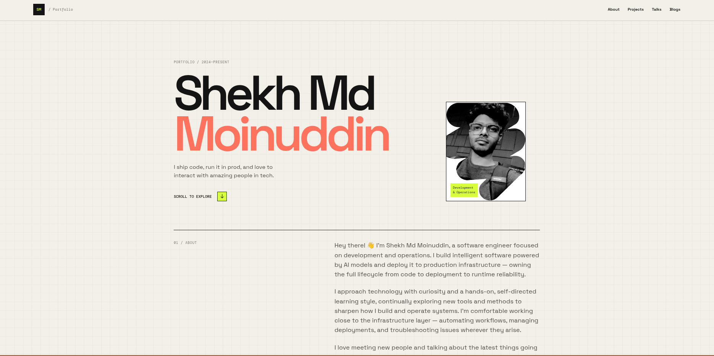

# Shekh Md Moinuddin — Portfolio


Personal portfolio site — I ship code, run it in prod, and love to interact with amazing people in tech.



## Sections

- **About** — intro, background, and how to reach out
- **Toolkit** — things I like to build with, grouped by category:
  - Development
  - Operations
  - AI / Agents (LangGraph, LangSmith, ChromaDB)
  - Hardware
- **Projects** — selected work (`/projects`)
- **Talks** — talks and appearances (`/talks`)
- **Contact** — GitHub, LinkedIn, X, and email

## Tech stack

| Tool | Purpose |
| ---- | ------- |
| [Astro](https://astro.build) | Static site framework |
| [React](https://react.dev) | Interactive components |
| [Tailwind CSS](https://tailwindcss.com) | Styling |
| [TypeScript](https://www.typescriptlang.org) | Type safety |

Content (toolkit, projects, talks, contacts) lives in Markdown under `src/content/`, so sections update without touching layout code.

## Getting started

```sh
npm install
npm run dev
```

Then open http://127.0.0.1:4321/.

```sh
npm run build    # type-check + production build
npm run preview  # preview the production build
```

## Project structure

```text
├── assets/               # README images
├── public/               # static assets (icons, images)
├── src/
│   ├── components/       # Astro + React components
│   ├── content/          # Markdown: tech-stacks, projects, talks, contacts
│   ├── layouts/          # page layouts
│   ├── pages/            # routes (/, /projects, /talks)
│   └── styles/           # global CSS
├── astro.config.mjs
└── tailwind.config.mjs
```

## Contact

- GitHub: https://github.com/noobyco
- LinkedIn: https://www.linkedin.com/in/shekh-md-moinuddin/
- X: https://twitter.com/noobyco
- Email: moinuddinshekh2@gmail.com
